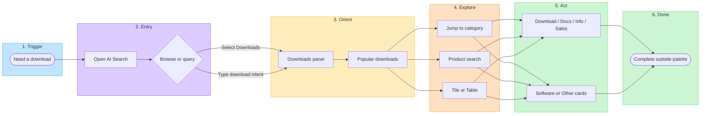

# HCC Downloads — Visualized user journey

Companion visual to [user-journey.md](./user-journey.md). Same journey as stages; this page is for scanning and sharing.

---

## Journey map (stages × experience)



---

## Swimlane — what the user does vs what the UI does

| Stage | User does | UI responds |
|-------|-----------|-------------|
| Trigger | Needs ISO / installer / package | — |
| Entry | Clicks Search or types a query | Palette opens; Downloads selected or routed |
| Orient | Scans Popular trio | Featured RHEL / OpenShift / Ansible cards |
| Explore | Jumps, searches, or toggles view | Category reorder + collapse; typeahead; highlight; tile/table |
| Act | Chooses Download / Docs / Info / Sales / card | Navigates to destination |
| Done | Installs or reads outside palette | Palette dismisses or stays until closed |

---

## Emotion / effort curve (qualitative)

```text
Effort
  ^
  |     open search
  |        *
  |       / \\        jump / search
  |      /   \\         *
  |     /     \\       / \\
  |    /       *-----*   \\____ download
  |   *                         *
  | need                      done
  +----------------------------------> Time
        Entry   Orient  Explore   Act
```

Peak effort is finding the right product in a long catalog. Jump + product search are meant to flatten that middle hump. Popular downloads skip Explore for common cases.

---

## Critical path (one line)

**Need download → Search → Downloads → Find product (Popular / Jump / Search) → Download → Install**

---

## FigJam (Red Hat org — combined)

[HCC Downloads — User flow & journey](https://www.figma.com/board/GiBwuo1WSwWiP9i6qLnWle) includes:

- User flow (decision / interaction path)
- Staged journey map (Trigger → Done)
- Swimlane — User vs UI
- Emotion / effort curve
